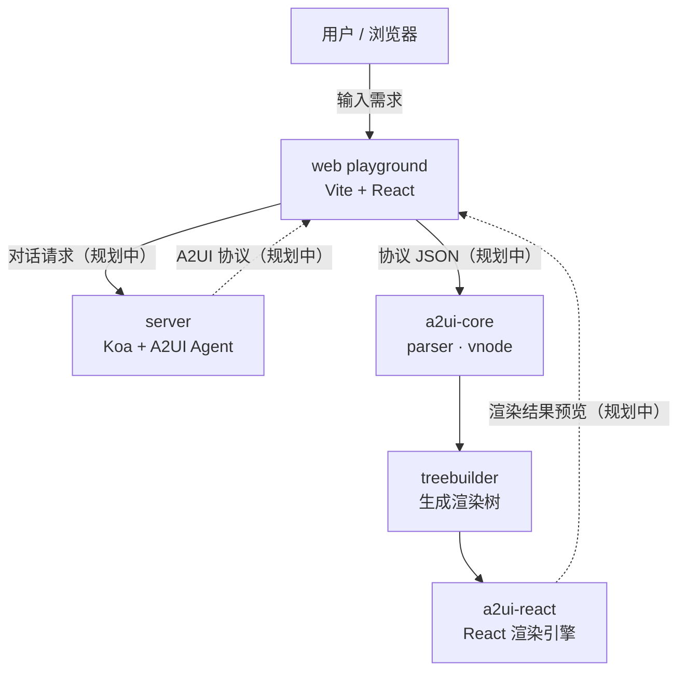

# A2UI Playground 项目架构与运行流程

> 本文基于当前仓库源码整理。
>
> **核心结论**：项目目前处于脚手架阶段。工程结构、workspace、构建链路已经搭好，但 `parser`、`vnode`、`treebuilder`、React 渲染器都还是空实现；server 只有健康检查接口，web 只渲染一行占位文字。README 中描述的「AI 对话生成 UI」完整链路尚未接通。

---

## 1. 项目定位

A2UI Playground 的目标是：用户通过 Web 应用与 AI Agent 对话，由 Agent 生成 A2UI 协议，再由渲染引擎把协议变成真实 UI，并支持多轮对话调整。

代码用 **monorepo + npm workspaces** 组织，分为三类：

| 类型 | 目录 | 作用 |
| --- | --- | --- |
| SDK 包 | `packages/*` | 维护 A2UI 协议解析、虚拟节点、渲染树与 React 渲染器，可发布为 npm 包 |
| Web 应用 | `web/*` | 对话、预览、组件示例、协议调试的 playground |
| 服务端 | `server/*` | 基于 OpenAI 的 A2UI Agent，以及协议生成与缓存 |

---

## 2. 整体架构

实线表示当前已经存在的代码与构建关系；虚线表示 README 中规划、但尚未实现的运行链路。

---

## 3. 目录与文件职责

### 3.1 根目录

| 文件 | 职责 |
| --- | --- |
| `package.json` | 定义 npm workspaces（`packages/*`、`web/*`、`server/*`）和根脚本：`dev:web`、`dev:server`、`build`、`typecheck` |
| `package-lock.json` | 依赖锁定文件，保证各 workspace 安装一致 |
| `tsconfig.base.json` | 所有子包共享的 TypeScript 配置：ES2022、ESNext、Bundler 解析、`strict`、声明文件与 sourceMap |
| `README.MD` | 项目目标、模块划分与基础技术选型说明 |
| `.gitignore` | 忽略 `node_modules`、`dist`、`.env`、日志等 |
| `node_modules/@a2ui/*` | npm workspaces 建立的软链接，例如 `@a2ui/core` 指向 `packages/a2ui-core` |

### 3.2 `packages/a2ui-core`

A2UI 协议的核心 SDK，最终会被 web 和第三方使用。

| 文件 | 职责 |
| --- | --- |
| `package.json` | 包名 `@a2ui/core`，ESM 包；`main`/`types`/`exports` 指向 `dist`；`build` 使用 `tsc` |
| `src/index.ts` | 统一出口，重导出 `parser`、`treebuilder`、`vnode` |
| `src/parser/index.ts` | **空实现**。规划职责：把 A2UI 协议文本/JSON 解析成结构化描述 |
| `src/vnode/index.ts` | **空实现**。规划职责：把协议中的组件映射为虚拟节点并管理 |
| `src/treebuilder/index.ts` | **空实现**。规划职责：根据协议构建渲染树，并调用具体渲染器 |
| `tsconfig.json` | 继承根配置，`src` 编译到 `dist`，生成 `.d.ts` |
| `dist/*` | `tsc` 生成的构建产物，不应手动修改 |

### 3.3 `packages/a2ui-react`

基于 React 的 A2UI 渲染引擎，消费 `@a2ui/core` 产出的渲染树。

| 文件 | 职责 |
| --- | --- |
| `package.json` | 包名 `@a2ui/react`；依赖 `@a2ui/core`；`react`/`react-dom >=18` 作为 peerDependencies |
| `src/index.tsx` | **空实现**。规划职责：把 A2UI 渲染树转换为 React 组件并渲染 |
| `tsconfig.json` | 额外启用 `DOM` 类型与 `react-jsx` |
| `dist/*` | `tsc` 生成的构建产物 |

### 3.4 `web/a2ui-playground`

用户实际访问的 playground，技术栈为 Vite + React 19。

| 文件 | 职责 |
| --- | --- |
| `index.html` | Vite 入口 HTML，包含 `
` 并加载 `/src/main.tsx` |
| `src/main.tsx` | 浏览器启动入口：`createRoot(#root)`，用 `StrictMode` 渲染 `App` |
| `src/App.tsx` | **占位页面**，目前只渲染 `A2UI Playground` 文本 |
| `src/vite-env.d.ts` | 引入 Vite 客户端类型 |
| `vite.config.ts` | 启用 React 插件；把 `@a2ui/core`、`@a2ui/react` 别名指向各自 `src`；开发端口 `5173` |
| `package.json` | 脚本 `dev`/`build`/`preview`/`typecheck`；依赖 React、`@a2ui/core`、`@a2ui/react` |
| `tsconfig.json` | `noEmit`，仅做类型检查；启用 DOM 与 JSX |
| `dist/*` | `vite build` 生成的静态站点产物 |

> 关键点：`vite.config.ts` 的 alias 直接指向 package 的 **源码目录**，因此开发 web 时不需要先构建 `a2ui-core` / `a2ui-react`。生产构建同样走 alias，会把源码一起打包。

### 3.5 `server/a2ui-playground-server`

独立运行的服务端进程，技术栈为 Koa 3 + OpenAI SDK。

| 文件 | 职责 |
| --- | --- |
| `src/index.ts` | 创建 Koa 应用与 Router；注册 CORS；仅实现 `GET /health`；监听 `PORT`（默认 `3000`）。文件内有 TODO：后续接入 OpenAI Agent 与协议缓存 |
| `package.json` | `dev` 使用 `ts-node src/index.ts`；`build` 使用 `tsc`；`start` 运行 `dist/index.js`；依赖 koa、router、cors、openai |
| `tsconfig.json` | 使用 `NodeNext` 模块解析，启用 node 类型 |
| `dist/*` | `tsc` 生成的构建产物 |

---

## 4. 实际运行流程

当前项目只有两个可运行的进程入口：**web** 和 **server**。两个 package 是库，不单独启动。

### 4.1 启动 Web：`npm run dev:web`

1. 根 `package.json` 转调 `npm run dev -w @a2ui/playground`。
2. 该 workspace 执行 `vite`，启动开发服务器 `http://localhost:5173`。
3. Vite 读取 `index.html`，把 `/src/main.tsx` 当作入口模块处理。
4. `@vitejs/plugin-react` 负责 JSX/React Refresh 转译。
5. `main.tsx` 执行：找到 `#root` → `createRoot` → 在 `StrictMode` 中渲染 `<App />`。
6. `App.tsx` 返回静态文本 `A2UI Playground`，页面渲染结束。

补充：

- 虽然 `@a2ui/core`、`@a2ui/react` 已声明为依赖并配置了 alias，但 `App.tsx` 目前没有 import 它们，所以这两个包在运行时**并未真正执行**。
- 开发模式下修改 `packages/*/src` 会被 Vite 直接热更新，无需重新 build。

### 4.2 启动 Server：`npm run dev:server`

1. 根 `package.json` 转调 `npm run dev -w @a2ui/playground-server`。
2. 该 workspace 执行 `ts-node src/index.ts`，直接运行 TypeScript。
3. 代码创建 Koa 实例、Router、CORS 中间件，并挂载路由。
4. 访问 `GET http://localhost:3000/health` 返回 `{ "status": "ok" }`。
5. 其他路径没有注册路由，返回 404。

补充：

- `openai` 依赖已安装，但 `src/index.ts` 尚未调用，因此启动时不会请求任何模型。
- web 的 `vite.config.ts` 没有配置 proxy，`App.tsx` 也没有发起请求，**目前前后端互不通信**。

### 4.3 构建与类型检查

`npm run build` 会按 workspace 依次执行 `build`（存在才执行）：

| Workspace | 构建行为 |
| --- | --- |
| `@a2ui/core` | `tsc -p tsconfig.json` → `dist` |
| `@a2ui/react` | `tsc -p tsconfig.json` → `dist` |
| `@a2ui/playground-server` | `tsc -p tsconfig.json` → `dist` |
| `@a2ui/playground` | `tsc --noEmit` 类型检查 + `vite build` 输出静态站点 |

`npm run typecheck` 会对每个 workspace 执行 `tsc --noEmit`。

---

## 5. 设计目标中的完整链路

README 规划的用户流程如下：

1. 用户在 web playground 的对话区输入需求。
2. web 把对话请求发送给 server。
3. server 的 A2UI Agent 调用 OpenAI，生成 A2UI 协议。
4. server 缓存协议（便于多轮修改与复用）。
5. web 收到协议 JSON。
6. `a2ui-core/parser` 把协议解析成结构化描述。
7. `a2ui-core/vnode` 把描述映射为虚拟节点。
8. `a2ui-core/treebuilder` 生成渲染树，并调用指定渲染器。
9. `a2ui-react` 把渲染树变成 React 组件，在预览区展示。
10. 用户继续对话，Agent 只修改协议中变化的部分，重新走 6–9 完成增量更新。

---

## 6. 当前实现进度与注意事项

| 模块 | 状态 |
| --- | --- |
| monorepo / workspaces / TS 配置 | 已完成 |
| `a2ui-core` 的 parser / vnode / treebuilder | 仅空文件与注释，未实现 |
| `a2ui-react` 渲染引擎 | 仅空文件与注释，未实现 |
| web 对话、预览、组件示例、协议调试 | 仅占位页面 |
| server 健康检查 | 可用 |
| server 的 OpenAI Agent 与协议缓存 | TODO，未实现 |
| web ↔ server 通信 | 未实现（无请求代码、无 proxy） |

注意事项：

- `dist/` 是构建产物，源码修改后需要重新构建（web 开发模式例外，因为它直接使用 package 源码）。
- 根目录使用 **npm**（有 `package-lock.json`），不是 pnpm，尽管目录名容易让人误解。
- server 的 `tsconfig.json` 使用 `NodeNext`，但 `server/a2ui-playground-server/package.json` 没有声明 `"type": "module"`，因此当前源码按 CommonJS 编译运行。后续接入 ESM-only 的 OpenAI SDK 时需要确认模块格式一致。
- `.env` 已被 git 忽略，但项目中还没有实际读取环境变量的代码。
